* [Strona główna](/#przewodnik-po-let39s-map)
* [Szybki start](quick-start.md#szybki-start)
* [Przykładowe wydarzenie](features/sample-event.md#przykładowe-wydarzenie)
* [Panel organizatora](admin-panel.md#panel-organizatora)

[//]: # (* Lista wydarzeń)
[//]: # (  * [Dołącz do wydarzenia]&#40;&#41;)
[//]: # (  * [Aktualne wydarzenia]&#40;&#41;)
[//]: # (  * [Kopiowanie i resetowanie]&#40;&#41;)
[//]: # (  * [Historia i archiwum]&#40;&#41;)
[//]: # (  * [Ustawienia]&#40;&#41;)

* Zarządzanie wydarzeniem
  * [Tworzenie wydarzenia](event-management/creating-event.md#tworzenie-wydarzenia)
    * [Zaawansowane ustawienia wydarzenia](event-management/creating-event.md#_4-zaawansowane-ustawienia-gry)
  * [Zarządzanie kategoriami punktów](event-management/managing-point-categories.md#zarządzanie-kategoriami-punktów)
  * [Zarządzanie punktami](event-management/managing-points.md#zarządzanie-punktami)
  * [Zapraszanie uczestników i organizatorów](event-management/inviting-participants-organizers.md#zapraszanie-uczestników-i-organizatorów)
  * [Zarządzanie uczestnikami](event-management/managing-participants.md#zarządzanie-uczestnikami)
  * [Monitorowanie postępów drużyn](event-management/scoreboard.md#monitorowanie-postępów-drużyn)
  * [Problemy techniczne (Internet, GPS)](event-management/connection-issues.md#problemy-związane-z-brakiem-internetu-lub-lokalizacji-gps)

[//]: # (* [Zarządzanie kontem]&#40;&#41;)

* Funkcjonalności
  * [Aktualności w wydarzeniu](features/notifications.md#aktualności-w-wydarzeniu)
    * [Przykładowy wygląd](features/notifications.md#przykładowy-wygląd-aktualności)
    * [Jak wysłać aktualność?](features/notifications.md#jak-wysłać-aktualności)
    * [Jak zarządzać aktualnościami?](features/notifications.md#jak-zarządzać-aktualnościami)
  * [Plecak drużyny](features/backpack.md?id=plecak-drużyny)
  * [Atrybuty przedmiotów](features/item-attributes.md#atrybuty-przedmiotów)
  * [Tryb ciemności](features/map-darkness.md#tryb-ciemności)
  * [Zadania punktów](features/point-challenges.md#zadania-punktów)
    * [Skąd zebrać punkt?](features/point-challenges.md#skąd-drużyna-może-zebrać-punkt)
    * [Rodzaje zadań](features/point-challenges.md#rodzaje-zadań)
    * [Podpowiedzi](features/point-challenges.md#podpowiedzi)
    * [Kto odpowiada na zadanie?](features/point-challenges.md#kto-odpowiada-na-zadanie)
    * [Narzędzia organizatora](features/point-challenges.md#narzędzia-organizatora)
  * [Widok gracza](features/player-view.md#widok-gracza)
  * [Wirtualny ruch](features/virtual-movement.md#wirtualny-ruch)
  * [Sklep w aplikacji](features/market.md?id=sklep-w-aplikacji)
      * [Jak korzystać?](features/market.md#jak-korzystać-ze-sklepu)
      * [Zaawansowane funkcje](features/market.md#zaawansowane-funkcje)
      * [Najczęstsze problemy](features/market.md#najczęstsze-problemy)

* Aktualizacje wersji
  * [6.3.0](versions/6.3.0.md#wersja-630)
  * [6.2.0](versions/6.2.0.md#wersja-620)
  * [6.1.0](versions/6.1.0.md#wersja-610)
  * [6.0.0](versions/6.0.0.md#wersja-600)
  * [5.9.0](versions/5.9.0.md#wersja-590)
  * [5.8,0](versions/5.8.0.md#wersja-580)
  * [5.7,0](versions/5.7.0.md#wersja-570)
  * [5.6.12](versions/5.6.12.md#wersja-5612)

[//]: # (* [Masz pytania?]&#40;&#41;)
[//]: # (* Poradniki)
[//]: # (  *  [Jak stworzyć pierwsze wydarzenie?]&#40;tutorials/first-event.md&#41;)
